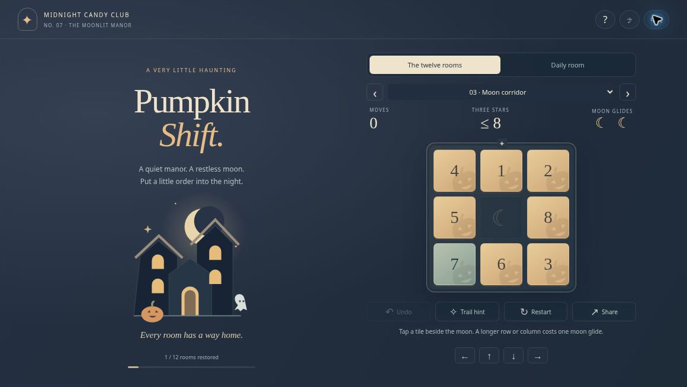
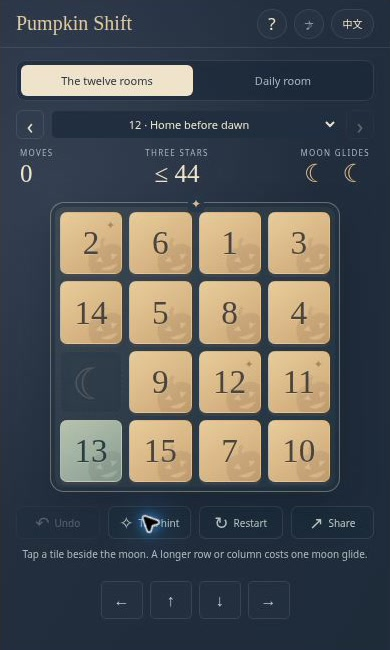

# Pumpkin Shift — Halloween Sliding Puzzle with Moon Glides

**Twelve rooms. One empty space. A way home before dawn.** Pumpkin Shift is a Halloween number-sliding game that begins with approachable 3×3 puzzles and opens into a 4×4 manor. Two limited Moon Glides let you move a whole line in one turn while preserving the logic of the classic 8-puzzle and 15-puzzle.

[**GitHub Pages deployment target**](https://ashintop.github.io/halloween-pumpkin-shift/) · [Watch the visual introduction](docs/media/intro.mp4) · [Rules](#how-to-play) · [Embedding](#embed-pumpkin-shift)

**Deployment status:** GitHub Pages is not live yet. The `ashintop.github.io` links in this document are intended deployment addresses. Use the local-run instructions until the hosted game has been published and verified.

[Video player and transcript (deployment target)](https://ashintop.github.io/halloween-pumpkin-shift/intro.html) · [Captioned MP4 file](docs/media/intro.mp4). The 24-second silent introduction uses actual game screenshots; it is not a live gameplay recording.

[](docs/media/intro.mp4)

If this little manor earns a place in your puzzle collection, **[star Pumpkin Shift on GitHub](https://github.com/AshinTop/halloween-pumpkin-shift)**. Issues with the room number and a reproducible move sequence help us improve it.

## A familiar puzzle with a little moonlight

- **12 fixed campaign rooms:** eight 3×3 puzzles, followed by four 4×4 puzzles.
- **Two Moon Glides per room:** slide a continuous row or column toward the empty space in one turn.
- **Verified solutions and fair targets:** every campaign room has a complete legal solution, and every three-star move target has an executable proof path.
- **A daily 3×3 room:** a deterministic shuffle based on the UTC calendar date.
- **Safe trail hints:** highlight a legal next tile along a route that can always return to the goal.
- **Undo, restart, and local progress:** restore the previous board and resources; keep current play, best move counts, and stars in the same browser.
- **Mouse, touch, and keyboard controls**, English and Simplified Chinese, reduced-motion support, and optional locally synthesized sound.
- **Original vector art:** a slate-blue manor, brass-colored moonlight, pumpkin tiles, and sage-green numbers that have found their place.

Pumpkin Shift was designed for [2048 Online](https://2048online.top) and the Midnight Candy Club collection. It is a standalone static game, not a 2048 merge variant: the numbers slide into order and do not combine.

## How to play

### Restore the room

Arrange the numbers from left to right and top to bottom. Leave the empty moon square at the bottom-right corner. Tap a tile directly next to the empty space to slide it into that space.

There is no countdown or hard move limit. The three-star target rewards efficiency; taking more moves still lets you finish the room. Correctly placed numbers change to a calm green so the board's progress is easy to read.

### Spend a Moon Glide

A tile farther away can move if it shares the empty space's row or column and you have a Moon Glide left. Select that tile to slide the entire intervening line toward the gap. The action counts as one move and consumes one of the room's two glides.

Ordinary adjacent slides are unlimited and never consume moonlight. A glide is a compact sequence of legal traditional moves, so it does not create an otherwise unreachable board. Undo restores the glide when you undo that action.

### Follow a trail when you get lost

**Trail Hint** highlights one safe next tile. The game starts with a known route obtained by reversing its legal shuffle. If you take another path, the hint route can first retrace some of your moves and then reconnect to the original solution.

This guarantees a route home but **does not claim to be the shortest solution**. Asking for a hint does not move a tile or consume a turn. Tap the highlighted tile when you are ready.

## Controls

| Action | Input |
| --- | --- |
| Slide a neighboring tile | Click or tap it |
| Move the empty square | Arrow keys or visible direction buttons |
| Moon Glide | Click a farther tile in the same row or column |
| Undo | **Z** or Undo |
| Highlight a safe next step | Trail Hint |
| Restart the current room | Restart |
| Choose another room | Room selector or previous/next buttons |
| Help, sound, language | Header buttons |

The direction buttons are visible on touch devices. In narrow portrait layouts they are 38 px high. Keyboard commands are ignored while the help dialog or an input control needs them.

## Campaign and daily links

All campaign rooms are available from the selector:

- [Start with room 1](https://ashintop.github.io/halloween-pumpkin-shift/?level=1)
- [Try the first 4×4 room](https://ashintop.github.io/halloween-pumpkin-shift/?level=9)
- [Play today's room](https://ashintop.github.io/halloween-pumpkin-shift/?mode=daily)
- [Revisit the October 31, 2026 daily room](https://ashintop.github.io/halloween-pumpkin-shift/?mode=daily&date=2026-10-31)

The Share button includes the selected daily date, so the recipient gets the same puzzle even on a later day. Invalid room numbers or calendar dates fall back safely. The daily room uses UTC midnight; a player's local calendar date can differ.

## Frequently asked questions

### Is every puzzle solvable?

Every campaign and daily board is created by making legal moves from the completed board. The campaign also has automated full-solution checks. All 12 campaign three-star targets have separately recorded legal paths, and the daily target can be reached by its ordinary reverse-shuffle route without magic.

### Are hints an optimal solver?

No. They provide a safe route, possibly with backtracking. This avoids falsely presenting a long route as the mathematical minimum and keeps the implementation deterministic even for 4×4 positions.

### Can I run out of moves?

No. A star target is an efficiency goal, not a failure timer. You can keep moving, use hints, undo, or restart.

### What is saved?

Current play, best move counts, stars, language, and sound preference are stored locally when available. Reloading can restore the current board, but the Undo stack belongs to the current page session. There is no account, online leaderboard, or cross-device synchronization. If storage is unavailable, the game remains playable.

### Is it suitable for small game windows?

The board uses the iframe's actual available area. Large windows can show the manor illustration; short landscape windows place tools beside the board. See [EMBEDDING.md](EMBEDDING.md) for browser viewport checks and integration guidance. Those checks do not imply testing every physical mobile device.

## Run locally

Serve the repository root:

```sh
python3 -m http.server 4173
```

Open [http://localhost:4173](http://localhost:4173). The project is buildless and has no npm dependencies, API keys, runtime CDN, or external game player. HTTP or HTTPS is needed for reliable ES module loading; `file://` may be blocked by the browser.

## Verify the game

```sh
npm test
```

For detailed individual test output:

```sh
node tests/engine.test.js
```

The **11 checks** cover all campaign solutions, every three-star target, deterministic daily rooms, full-line move costs, depleted magic, route recovery after arbitrary detours, row boundaries, strict URL/date parsing, and malformed stored data. Engine tests are complemented by separate browser layout and interaction review.

## Compact-player walkthrough



Use a direction button for a single adjacent slide, or tap a numbered tile. A farther tile in the empty square’s row or column spends one Moon Glide. Watch the move count and moonlight together when planning a shorter route.

*Actual interface captured in a browser iframe sized for the host player. This is a compact-window illustration, not a physical-phone test.*

## Embed Pumpkin Shift

```html
<iframe
  src="https://ashintop.github.io/halloween-pumpkin-shift/"
  title="Pumpkin Shift — Halloween sliding puzzle"
  width="100%"
  height="654"
  scrolling="no"
  allow="fullscreen"
  style="display:block;border:0"
></iframe>
```

The game always uses a bounded player layout and needs no special embed parameter. Leave room for the host's own toolbar instead of placing it over the game. No parent-document access, camera, microphone, or pointer lock is used. Storage restrictions only affect persistence. [EMBEDDING.md](EMBEDDING.md) provides the complete host-window notes.

## Source and design

| File | Responsibility |
| --- | --- |
| `engine.js` | Board rules, deterministic rooms, safe routes, validation |
| `app.js` | Interaction, rendering, translations, saves, sound, sharing |
| `index.html`, `style.css`, `icon.svg` | Original manor artwork and responsive interface |
| `tests/engine.test.js` | Rule checks and complete solution proofs |
| [DESIGN.md](DESIGN.md) | Game-design intent, fairness, and visual direction |

## More games for a moonlit break

- **[Pumpkin 2048](https://github.com/AshinTop/halloween-2048)** — classic number merging and three positional Lantern Trials.
- **[Ghost Lanterns 3D](https://github.com/AshinTop/halloween-3d)** — spatial Lights Out puzzles with linked pumpkin lamps.
- **[Haunted Hearts](https://github.com/AshinTop/halloween-love-game)** — two friendly ghosts cooperate through eight puzzle rooms.
- **[Trick-or-Treat TriPeaks](https://github.com/AshinTop/halloween-tripeaks)** — a 52-card Halloween game with eight verified rescue deals.

## Credits

Created for **AshinTop** and **Midnight Candy Club**, with AI-assisted design, implementation, and review. The manor, tile art, interface, and synthesized sounds were created for this project. The game is an independent treatment of traditional sliding-number puzzles. It includes no analytics, payments, advertisements, or remote account system.
